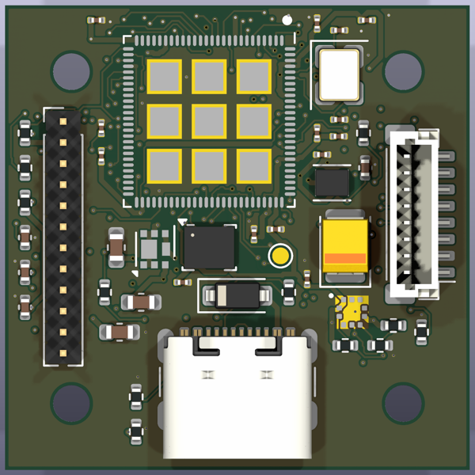
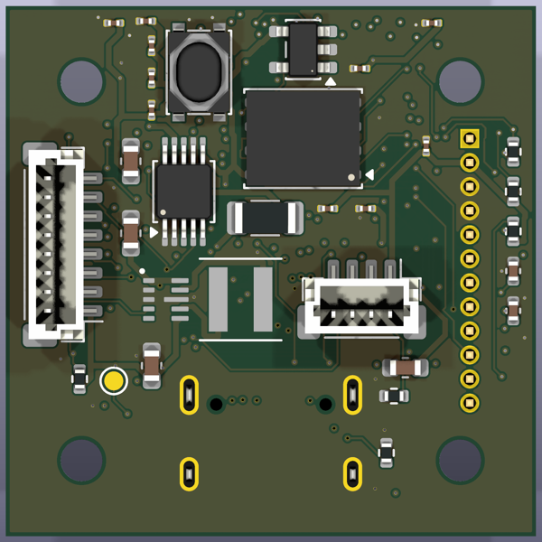
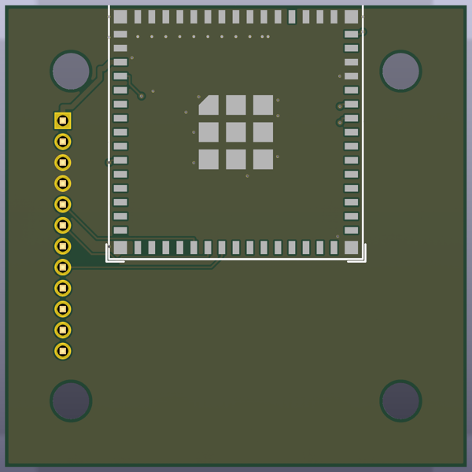
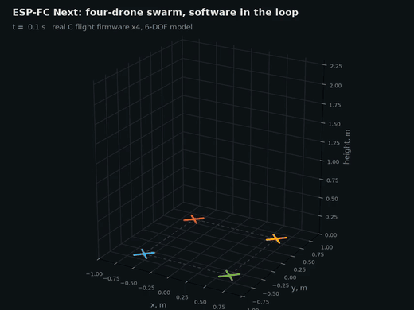
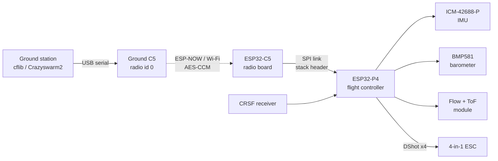
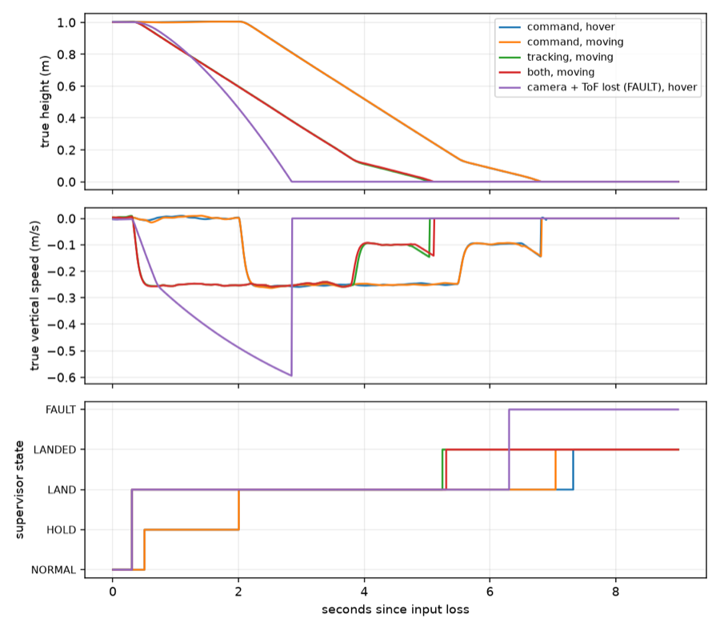

<div align="center">

# ESP-FC Next

**An open dual-chip flight controller for indoor drone swarms: ESP32-P4 flies, ESP32-C5 talks.**

[](https://github.com/ALVAROI12/esp-fc-next/actions/workflows/ci.yml)






<sub>28 mm flight controller (top, bottom) and the C5 radio board that stacks on it. KiCad renders of the autorouted boards.</sub>

[Quick start](#quick-start) · [Verification gates](#verification-gates) · [Hardware](#hardware) · [Docs](#documentation) · [Contributing](CONTRIBUTING.md)

</div>

> [!WARNING]
> **Simulation only. No board has been built and nothing has flown.** The firmware has never run on this
> hardware and the autorouted boards have had no human review. Do not order the boards or fly this firmware
> expecting it to work or be safe. Contributions and review are welcome: see [CONTRIBUTING.md](CONTRIBUTING.md).

Derived from [Espressif ESP-Drone](https://github.com/espressif/esp-drone) (Crazyflie-based), GPL-3.0.
The full plan, gap analysis and gates are in [`docs/ESP-FC-Next_Project_Plan.pdf`](docs/ESP-FC-Next_Project_Plan.pdf).

## Highlights

| | |
| --- | --- |
| **Real flight code in the loop** | The C flight core (`fc_step`, Kalman, controller) flies a 6-DOF model in SITL, at 1 or 4 kHz. |
| **Four-drone swarm in SITL** | `make swarm` flies four firmware copies in lockstep through link loss, camera dropout and low battery. All land. |
| **Failsafe landing** | Opt-in latched hold-and-land supervisor. Renewed commands cannot cancel LAND. |
| **Encrypted radio link** | P4 to C5 over SPI, Crazyflie CRTP inside an AES-CCM envelope, fuzzed with libFuzzer. cflib driver included. |
| **Hardware as code** | Both boards written in SKiDL, checked by 37 tests, routed against JLCPCB's 4-layer rules, simulated in ngspice with the routed copper. |

<div align="center">


<sub>`make video`: four copies of the real C flight firmware fly a 6-DOF model. Drone 3 loses its radio link mid-swap and lands by itself. Simulation, 2x speed.</sub>
</div>

## Architecture



## Verification gates

Nothing is bought or flown until gates G1 to G6 pass, in order.

| Gate | What it checks | Status |
| --- | --- | --- |
| **G1** Math model | Rigid-body model, loop margins, sensor noise, Monte Carlo | Pass ([report](sim/reports/g1/README.md)) |
| **G2** Software in the loop | Real flight C code flying the model; four-drone swarm | Hover pass; swarm 7/7 scenarios ([report](sim/reports/swarm/README.md)) |
| **G3** Code quality | Warnings as errors, cppcheck, clang-tidy, sanitizers, fuzzing, review checklist | Met on host |
| **G4** PCB | ERC/DRC, netlist checks, power-stage simulation, DFM | In progress: 32 checks pass, 5 known failures (battery-path copper, SPI link termination), no human review yet |
| **G5** Hardware in the loop | Real P4 with simulated sensors, motors off | Not started |
| **G6** Flight | Props off, tethered, single hover, 2 drones, 4 drones | Not started |

<details>
<summary><b>Current simulation status</b></summary>

1/4 kHz host/SITL variants, trajectory feedforward, and an optional RPM notch bank (Task 1.6b, synthetic
vibration only) are tested in simulation. The production P4 image still uses ESP-Drone's original task loop; the
new runtime has not been activated or timing-validated on hardware. Flow-only absolute XY positioning remains an
open failure.

An **opt-in latched hold-and-land supervisor** now has command/camera-loss SITL tests and a
[report](sim/reports/failsafe/README.md). Renewed commands cannot cancel LAND. Moving camera loss still allows
substantial XY drift. Camera loss above the 1.3 m ToF range triggers a bounded blind descent in a thrust band
below the learned hover thrust; permanent loss of every height source still ends in a fault/motor stop, not
guaranteed safe landing. It is not collision-safe or hardware-validated.

With qualified local flow/range, emergency velocity braking reduces nominal camera-loss excursion from 1.71-1.72 m
to **0.28-0.29 m** in SITL ([comparison](sim/reports/flow_braking/README.md)). Total-height-loss recovery remains
open; this does not close the absolute-positioning requirement.

`make swarm` flies four firmware copies in lockstep (layers, formation, diagonal swap) with link-loss,
camera-dropout and low-battery faults; all land safely in SITL ([report](sim/reports/swarm/README.md)). No downwash
model; low battery is a voltage step, not a discharge model.



</details>

## Quick start

macOS prerequisites:

```sh
brew install colima docker docker-buildx uv cmake ninja llvm cppcheck lcov
colima start --cpu 6 --memory 8 --disk 60 --vm-type vz
docker pull espressif/idf:release-v5.5
make sim-setup
```

Keep the checkout under `$HOME`: Colima mounts only that by default, and elsewhere the Docker builds fail with
`CMakeLists.txt not found` or a missing `build/mbedtls`.

Then:

```sh
make core-test   # flight algorithms on the PC, with ASan/UBSan
make sim-test    # model and software-in-the-loop tests
make swarm       # four drones, injected faults
make viewer      # 3D replay in the browser
```

<details>
<summary><b>All commands</b></summary>

| Command | What it does |
| --- | --- |
| `make flight` | Build P4 flight firmware (`FLIGHT_TARGET=esp32s3` for the old reference board) |
| `make flight-qemu` | Boot the ESP32-S3 flight image in QEMU and check the UART log (no P4/C5 machine, radio or sensors in QEMU) |
| `make radio` | Build C5 radio firmware |
| `make core-test` | Build flight algorithms on the PC with ASan/UBSan and run tests |
| `make core-coverage` | Test coverage report (`build/coverage/index.html`) |
| `tools/idf.sh firmware/flight -B build-esp32p4 menuconfig` | Any `idf.py` command inside the pinned container |
| `make sim-test` | Run simulation and model tests |
| `make g1` | Gate G1 math-model report ([`sim/reports/g1`](sim/reports/g1/README.md)) |
| `make vibration` | Task 1.6b vibration/notch report ([`sim/reports/vibration`](sim/reports/vibration/README.md)) |
| `make failsafe` | Opt-in latched landing/fault evidence ([`sim/reports/failsafe`](sim/reports/failsafe/README.md)) |
| `make flow-braking` | Camera-loss braking comparison and sampled stresses |
| `make link-fuzz` | libFuzzer run of the P4<->C5 link codec ([protocols](docs/protocols.md)); `FUZZ_SECONDS=60` for a smoke run |
| `make video` | Swarm mission GIF for this README and an MP4 in `build/` (needs ffmpeg) |
| `make viewer` | Interactive 3D simulation replay with charts (opens in the browser) |
| `make hw-setup` / `make hw` | Hardware venv; netlists, drawn KiCad sheets and the G4 checks (needs KiCad 10 + ngspice) |
| `make hw-pcb` | Placement, routing (pinned in `hardware/routes/`, Freerouting if it stops passing DRC), 3D renders, power-path plot |
| `make hw-gerbers` | JLCPCB Gerber/drill zips plus assembly BOM and pick-and-place CSVs |
| `make pdf` | Regenerate the project plan PDF |

</details>

## Hardware

Two 28 mm square boards as code (`hardware/boards.py`, SKiDL): the P4 flight controller and the C5-MINI-1 radio
board, stacked on a 1.27 mm 1x12 header, 1S only. `make hw` runs 37 checks (ERC, drawn-vs-code netlist,
pin-to-pad, firmware pin defaults, placement fit, routed copper DRC, and ngspice runs of the power path, the 3.3 V
rail and the SPI link with the resistance and inductance of the routed tracks). 32 pass; 5 are known failures
kept as expected-fail tests: the battery-path tracks are too thin (166 mOhm) and the SPI link needs series resistors. Both boards place and
autoroute with Freerouting (`make hw-pcb`; the clean routes are kept in `hardware/routes/`) and pass KiCad DRC
against **JLCPCB's 4-layer 1 oz rules** (0.09 mm track/space, 0.35/0.15 mm vias, 0.2 mm copper-to-edge, 0.1 mm
mask dam, through-hole 0.28 mm hole-to-copper). Details and sources: [`hardware/DESIGN.md`](hardware/DESIGN.md).

| | Flight controller | Radio board |
| --- | --- | --- |
| MCU | ESP32-P4NRW16X, 16 MB PSRAM | ESP32-C5-MINI-1 (2.4 + 5 GHz) |
| Sensors | ICM-42688-P IMU, BMP581 barometer, INA226 battery monitor | |
| Power | 1S, TPS63802 buck-boost to 3.3 V, TLV62569 core buck | 3.3 V from the stack |
| I/O | USB-C, 4x DShot, ESC current/telemetry, CRSF, flow/ToF connector | SPI + UART to the P4 |
| Parts / BOM lines | 75 / 37 | 8 / 7 |

<details>
<summary><b>Ordering from JLCPCB (not ordered yet)</b></summary>

**Fab: JLCPCB, 4 layers, 1 oz, 1.6 mm.** `make hw-gerbers` writes the upload set per board:

| File | Contents |
| --- | --- |
| `hardware/out/gerbers/<board>.zip` | Gerber X1 (Protel extensions), Excellon PTH/NPTH drills, drill maps |
| `hardware/out/assembly/<board>-bom.csv` | JLCPCB BOM: Comment, Designator, Footprint, LCSC Part # |
| `hardware/out/assembly/<board>-cpl.csv` | JLCPCB pick-and-place: Designator, Mid X, Mid Y, Layer, Rotation |

Mounting holes and test points are excluded. `hardware/out/` is git-ignored; regenerate with
`make hw-pcb && make hw-gerbers`.

LCSC numbers (table in `hardware/assembly.py`, looked up 2026-11-01): ICM-42688-P C1850418, BMP581 C5362283,
TPS63802 C2845237, TLV62569 C141836, INA226 C49851, W25Q128JVP C190862, DMP1022UFDF-7 C155358, DFE201610E-2R2M
C337891, USB4105-GF-A C3020560, JST BM08B-SRSS-TB C160394, BM04B-SRSS-TB C160390, B5819W C64885, PTS810 switch
C116501, 40 MHz 3225 crystal C426988. Passives are blank so JLCPCB matches them by value and footprint.

Decisions left for the order form:

- **ESP32-P4NRW16X**: mapped to JLCPCB's "ESP32-P4NRW16" listing C9900140808 (a JLCPCB Assembly item).
  Confirm it is the X (QFN104 10x10 mm, 16 MB PSRAM) variant before paying.
- **ESP32-C5-MINI-1**: no LCSC listing. Consign it or hand-solder.
- **0.47 uH XFL4020-471ME (L1)**: Coilcraft dropped the XFL4020 series; the drop-in XGL4020-471MEC is not on
  LCSC either. Consign it or pick a stocked 0.47 uH 4x4 mm inductor.
- **1.27 mm stack header**: no LCSC match. Hand-solder.
- Surface finish: the P4's 0.35 mm pitch LGA and the 0.2 to 0.25 mm pads need ENIG per JLCPCB.
- Check D1, C2 and the ICs' pin 1 rotations in JLCPCB's placement preview.
- JLCPCB's DFM check on upload is the final word on the footprints.

</details>

<details>
<summary><b>Known gaps</b></summary>

Known DRC leftovers, not fab-related: the FC stack header courtyard overlaps the H1/H2 hole courtyards and the
crystal courtyard overlaps H3; the C5 module courtyard overlaps the radio board's H1/H3 hole courtyards. The
autorouted copper has not been reviewed by a human (return paths, 40 MHz crystal, USB D+/D-, battery path width).
No 3D models for the P4 or C5; the ESPFC footprints have not been checked against a physical part. ICM-42688-P
Rev 1.8 datasheet still unreadable (TDK returns 403). Phase 2 kit not bought.

</details>

## Repository layout

| Path | Contents |
| --- | --- |
| `firmware/flight/` | ESP32-P4 flight firmware (ESP-Drone fork, imported with `git subtree`) |
| `firmware/fc_core/` | Host (PC) build of the portable flight algorithms + HAL shims and tests ([docs](docs/fc_core.md)) |
| `firmware/radio/` | ESP32-C5 radio co-processor firmware (SPI link, ESP-NOW swarm, Wi-Fi) |
| `sim/` | G1 math model, G2 software-in-the-loop (real firmware flying the 6-DOF model), 3D viewer ([docs](sim/README.md)) |
| `hardware/` | Flight-controller and radio boards as SKiDL/KiCad code, JLCPCB rules and outputs (Phase 3, [docs](hardware/DESIGN.md)) |
| `tools/` | Developer scripts, swarm dongle, ground tools |
| `docs/` | Project plan and protocol specs |

## Documentation

- [Project plan and gates](docs/ESP-FC-Next_Project_Plan.pdf)
- [System design](docs/system_design.md)
- [Portable flight core](docs/fc_core.md)
- [Radio link protocols](docs/protocols.md)
- [Flight-code review checklist](docs/review_checklist.md)
- [Hardware design inputs](hardware/DESIGN.md)
- [Simulation](sim/README.md)

## Pulling upstream ESP-Drone changes

```sh
git subtree pull --prefix firmware/flight https://github.com/espressif/esp-drone.git master --squash
```

## Safety

Never fly hardware that has not passed the verification gates described in the plan. Always fly with props
guarded, in a netted area, with an independent kill switch.

## License

GPL-3.0, see [LICENSE](LICENSE). Keeps the upstream ESP-Drone and Crazyflie copyright headers.
