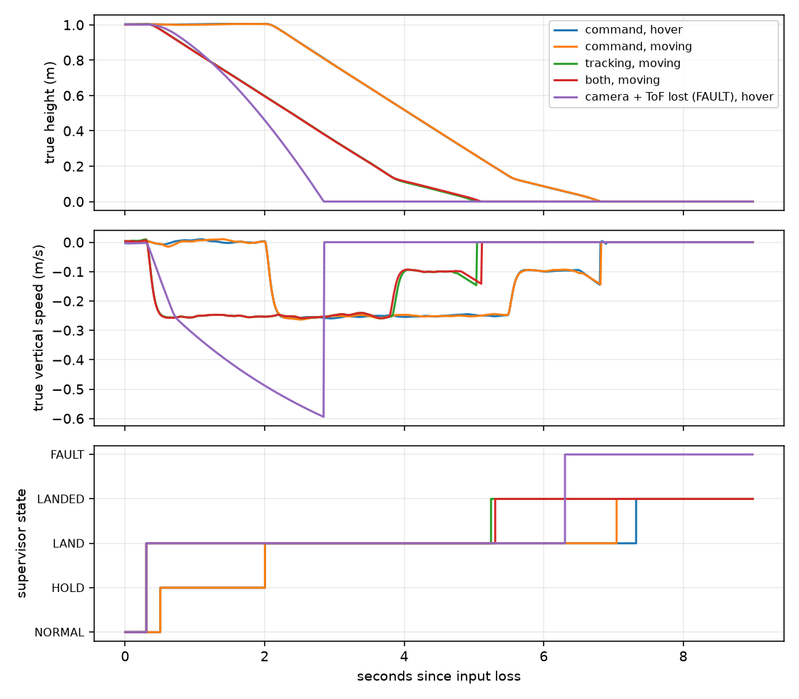

# Latched hold-and-land: SITL evidence

**Checks: PASS**

Real C runtime with opt-in safety enabled, 1/4 kHz variants, nominal 2-inch whoop model, seed 9. Not hardware validation, a collision guarantee, or a position-accuracy improvement.

Command loss: after 500 ms capture a fixed estimated pose, clear trajectory feedforward, hold 1.5 s, then descend. Tracking loss: after 300 ms start landing immediately; disable stale XY control and level. LAND remains latched when command/tracking input returns. Independent modeled ToF supports height. All-height loss produces FAULT/motor stop, **not** successful controlled landing.

| Rate/profile | Input loss | Motion | Recovery | State sequence | Landed after | Disarm height | Max descent / approach speed | Max XY drift | Check |
| --- | --- | --- | --- | --- | --- | --- | --- | --- | --- |
| whoop2_interim | command | hover | n/a | NORMAL@0.01s → HOLD@0.51s → LAND@2.01s → LANDED@7.32s | 7.319 s | 0.000 m | 0.257 / 0.153 m/s | 0.003 m | PASS |
| whoop2_interim | command | moving | n/a | NORMAL@0.01s → HOLD@0.51s → LAND@2.01s → LANDED@7.05s | 7.049 s | 0.000 m | 0.262 / 0.141 m/s | 0.302 m | PASS |
| whoop2_interim | tracking | moving | n/a | NORMAL@0.01s → LAND@0.31s → LANDED@5.37s | 5.369 s | 0.000 m | 0.261 / 0.138 m/s | 1.710 m | PASS |
| whoop2_interim | both | moving | n/a | NORMAL@0.01s → LAND@0.31s → LANDED@5.37s | 5.369 s | 0.000 m | 0.261 / 0.141 m/s | 1.311 m | PASS |
| whoop2_interim | command | hover | 0.800 s | NORMAL@0.01s → HOLD@0.51s → NORMAL@0.83s | n/a | n/a | n/a / n/a | 0.003 m | PASS |
| whoop2_interim | command | moving | 2.500 s | NORMAL@0.01s → HOLD@0.51s → LAND@2.01s → LANDED@7.05s | 7.049 s | 0.000 m | 0.262 / 0.141 m/s | 0.302 m | PASS |
| whoop2_interim | tracking | moving | 0.800 s | NORMAL@0.01s → LAND@0.31s → LANDED@5.41s | 5.409 s | 0.000 m | 0.258 / 0.143 m/s | 1.967 m | PASS |
| whoop2_interim | camera + ToF (FAULT case) | hover | n/a | NORMAL@0.01s → LAND@0.31s → FAULT@6.31s | n/a | 0.000 m | 0.581 / 0.581 m/s | 0.028 m | PASS (fault containment only) |
| whoop2_4k | command | hover | n/a | NORMAL@0.00s → HOLD@0.50s → LAND@2.00s → LANDED@7.32s | 7.324 s | 0.000 m | 0.259 / 0.145 m/s | 0.002 m | PASS |
| whoop2_4k | command | moving | n/a | NORMAL@0.00s → HOLD@0.50s → LAND@2.00s → LANDED@7.04s | 7.044 s | 0.000 m | 0.263 / 0.143 m/s | 0.292 m | PASS |
| whoop2_4k | tracking | moving | n/a | NORMAL@0.00s → LAND@0.30s → LANDED@5.24s | 5.244 s | 0.000 m | 0.259 / 0.146 m/s | 1.691 m | PASS |
| whoop2_4k | both | moving | n/a | NORMAL@0.00s → LAND@0.30s → LANDED@5.30s | 5.304 s | 0.000 m | 0.259 / 0.141 m/s | 1.330 m | PASS |
| whoop2_4k | command | hover | 0.800 s | NORMAL@0.00s → HOLD@0.50s → NORMAL@0.82s | n/a | n/a | n/a / n/a | 0.002 m | PASS |
| whoop2_4k | command | moving | 2.500 s | NORMAL@0.00s → HOLD@0.50s → LAND@2.00s → LANDED@7.04s | 7.044 s | 0.000 m | 0.263 / 0.143 m/s | 0.292 m | PASS |
| whoop2_4k | tracking | moving | 0.800 s | NORMAL@0.00s → LAND@0.30s → LANDED@5.46s | 5.464 s | 0.000 m | 0.257 / 0.144 m/s | 1.960 m | PASS |
| whoop2_4k | camera + ToF (FAULT case) | hover | n/a | NORMAL@0.00s → LAND@0.30s → FAULT@6.30s | n/a | 0.000 m | 0.594 / 0.594 m/s | 0.011 m | PASS (fault containment only) |

## Gates and interpretation

- Controlled cases: terminal LANDED, motors zero, disarm below 4 cm truth height, sampled approach speed <= 0.35 m/s, max LAND descent <= 0.5 m/s, no FAULT/tumble/assertion and no return to NORMAL after LAND.
- Command-only loss with healthy tracking: <= 25 cm XY excursion from the first HOLD sample. The table's drift starts at input loss and includes the 500 ms detection delay/braking transient.
- Recovery during HOLD resumes commands; recovery during LAND must not cancel landing. The restored-camera case injects a (+0.5, -0.4, 0) m reference jump at 0.8 s. Controller roll/pitch targets must remain zero after that restoration (no XY reacquisition).
- All-height-loss case passes only **fault containment**, not the controlled-landing gate. Its impact speed and drift must not be interpreted as successful landing.

## Limits

- No bounded XY drift after camera loss; a moving vehicle can continue drifting into obstacles. Flow-only absolute accuracy (FLOW-01) remains unmet. This is not collision-safe swarm flight.
- ToF uses an ideal flat ground plane with Gaussian noise and no real offset/occlusion. Touchdown is a height/vertical-speed dwell heuristic, not a contact sensor.
- Approach speed is the last 100 Hz logged pre-contact vertical speed; the ground model clamps vertical velocity on contact. It is not a measured physical impact speed.
- Input freshness measures receipt, not acquisition time, replay detection, estimator covariance or sensor accuracy. Plausible-but-frozen measurements are not detected.
- No fresh height means guaranteed controlled landing is impossible. FAULT containment stops motors; it can cause a fall. Faulted/landed states need explicit ground reinitialization.
- The production P4 image still uses the original task loop. Drivers, deadlines and hardware touchdown are unvalidated. Safe mode remains opt-in.

