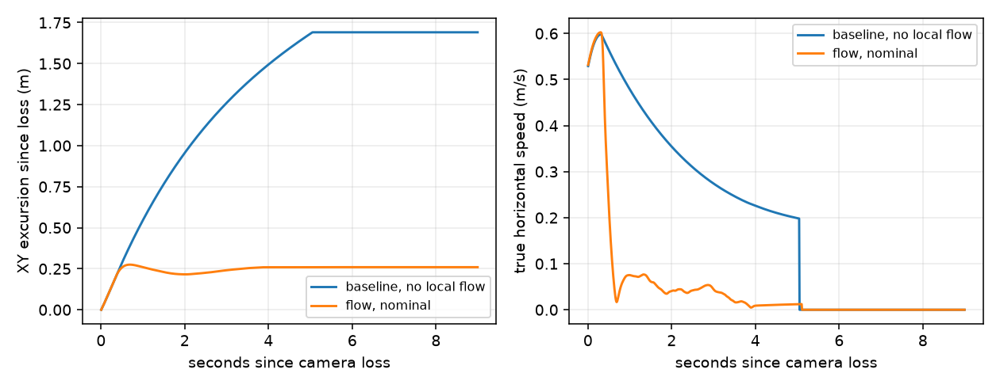

# Flow-aided emergency braking

**Declared checks: PASS**

Same real C runtime and nominal 2-inch model, both loop rates. All losses start while moving. Local flow has its own seeded RNG; no ground-truth velocity/position is sent to the controller except through the explicitly modeled sensors. Baseline is the previous level-descent behavior.

| Profile | Case | Max XY excursion | Max descent | Sampled approach | Drift gate | Result |
| --- | --- | --- | --- | --- | --- | --- |
| whoop2_interim | baseline, no local flow | 1.712 m | 0.261 m/s | 0.131 m/s | baseline only | PASS |
| whoop2_interim | flow, nominal | 0.290 m | 0.287 m/s | 0.132 m/s | 0.35 m | PASS |
| whoop2_interim | flow, seed 1 | 0.327 m | 0.292 m/s | 0.135 m/s | 0.50 m | PASS |
| whoop2_interim | flow, seed 5 | 0.346 m | 0.289 m/s | 0.139 m/s | 0.50 m | PASS |
| whoop2_interim | flow, scale -20% | 0.294 m | 0.283 m/s | 0.133 m/s | 0.50 m | PASS |
| whoop2_interim | flow, scale +20% | 0.286 m | 0.292 m/s | 0.132 m/s | 0.50 m | PASS |
| whoop2_interim | flow, delay 20ms | 0.291 m | 0.288 m/s | 0.132 m/s | 0.50 m | PASS |
| whoop2_interim | flow, yaw 90deg | 0.290 m | 0.284 m/s | 0.136 m/s | 0.50 m | PASS |
| whoop2_interim | flow, doubled pixel noise | 0.290 m | 0.289 m/s | 0.132 m/s | 0.50 m | PASS |
| whoop2_interim | flow, rotation factor -20% | 0.292 m | 0.285 m/s | 0.132 m/s | 0.50 m | PASS |
| whoop2_interim | flow, rotation factor +20% | 0.288 m | 0.291 m/s | 0.132 m/s | 0.50 m | PASS |
| whoop2_interim | flow, sensor mount yaw 15deg | 0.289 m | 0.287 m/s | 0.132 m/s | 0.50 m | PASS |
| whoop2_interim | flow, ToF reads 2 cm long | 0.289 m | 0.307 m/s | 0.116 m/s | 0.50 m | PASS |
| whoop2_interim | flow, restored jumped camera | 0.290 m | 0.287 m/s | 0.132 m/s | 0.35 m | PASS |
| whoop2_4k | baseline, no local flow | 1.693 m | 0.259 m/s | 0.139 m/s | baseline only | PASS |
| whoop2_4k | flow, nominal | 0.277 m | 0.275 m/s | 0.133 m/s | 0.35 m | PASS |
| whoop2_4k | flow, seed 1 | 0.328 m | 0.269 m/s | 0.140 m/s | 0.50 m | PASS |
| whoop2_4k | flow, seed 5 | 0.346 m | 0.268 m/s | 0.143 m/s | 0.50 m | PASS |
| whoop2_4k | flow, scale -20% | 0.283 m | 0.272 m/s | 0.134 m/s | 0.50 m | PASS |
| whoop2_4k | flow, scale +20% | 0.271 m | 0.279 m/s | 0.132 m/s | 0.50 m | PASS |
| whoop2_4k | flow, delay 20ms | 0.278 m | 0.281 m/s | 0.132 m/s | 0.50 m | PASS |
| whoop2_4k | flow, yaw 90deg | 0.281 m | 0.270 m/s | 0.135 m/s | 0.50 m | PASS |
| whoop2_4k | flow, doubled pixel noise | 0.277 m | 0.276 m/s | 0.132 m/s | 0.50 m | PASS |
| whoop2_4k | flow, rotation factor -20% | 0.280 m | 0.273 m/s | 0.133 m/s | 0.50 m | PASS |
| whoop2_4k | flow, rotation factor +20% | 0.274 m | 0.278 m/s | 0.133 m/s | 0.50 m | PASS |
| whoop2_4k | flow, sensor mount yaw 15deg | 0.277 m | 0.274 m/s | 0.133 m/s | 0.50 m | PASS |
| whoop2_4k | flow, ToF reads 2 cm long | 0.276 m | 0.292 m/s | 0.118 m/s | 0.50 m | PASS |
| whoop2_4k | flow, restored jumped camera | 0.277 m | 0.275 m/s | 0.133 m/s | 0.35 m | PASS |

## Policy and limits

- Safe mode brakes XY to zero velocity only with fresh qualified flow and downward range. Missing/rejected flow or near-ground range falls back to explicitly degraded level descent.
- Once local braking starts, restored camera packets are not fused during that LAND: no reacquisition of a jumped frame. LAND remains latched.
- Nominal gate <= 0.35 m; declared sampled stress gate <= 0.50 m. Controlled-landing truth/motor checks from `failsafe_report.py` must also pass. These are not 5 cm positioning gates.
- Sensor pixel noise/calibration are synthetic. Flow equations mirror the existing EKF except for the declared structural stresses (rotation-compensation factor +/-20%, 15 deg sensor mounting yaw, +2 cm ToF offset); this is not independent sensor calibration.
- A ToF that reads 2 cm short reports negative range on the ground, so safe mode refuses to arm (fail-safe, but real sensors need offset calibration before flight).
- Lighting, surface texture, wind, arbitrary speeds/heights, long latencies and all corruption patterns are not validated. Finite frozen sensor data is not detected by receipt freshness.
- Camera+ToF loss without another qualified height source still FAULTs. This change does NOT solve total-height loss or FLOW-01. Barometer/contact redundancy requires a separate validated stage.
- The free-model research attempts were quota-blocked; no independent multi-agent review is claimed. Research sources and vertical limitations are in `reports/Resilient landing without camera.md`.
- Production P4 runtime/drivers and physical flight remain unvalidated.
