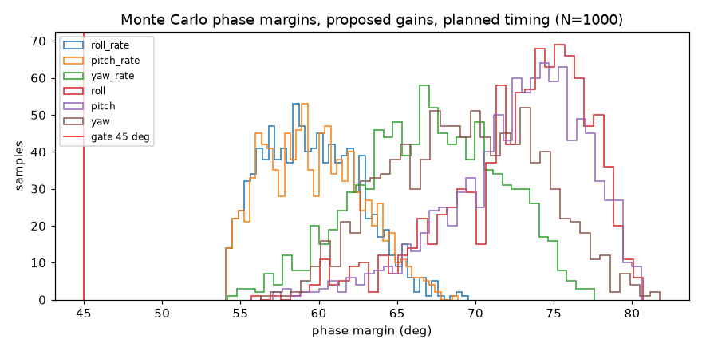
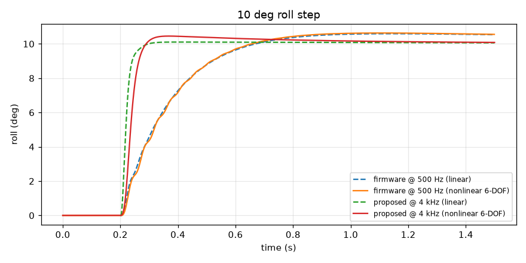
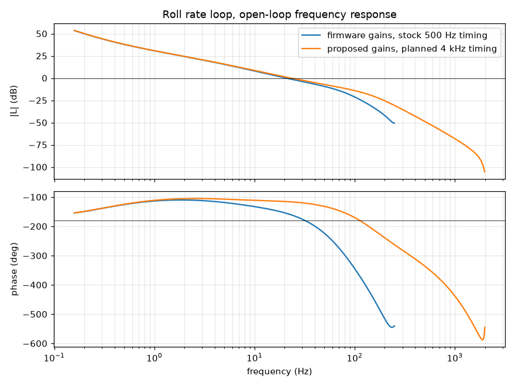

# Gate G1 - math model report

Generated by `sim/g1_report.py` in 49 s. **Gate G1: PASS**
for the target design (proposed gains + planned 4 kHz timing).

## Gate checks

| Check | Result |
| --- | --- |
| Nominal margins, all six loops (PM>=45 deg, GM>=6 dB) | pass |
| Monte Carlo, 1000 samples, zero gate failures | pass |
| 10 deg roll step overshoot <= 15 % (nonlinear) | pass |
| Linear and nonlinear overshoot agree within 5 points | pass |
| Hover with ICM-42688-P noise: attitude RMS < 0.5 deg | pass |
| Tuned gains are interior to their search grids | pass |
| Interim profile nominal and sampled margins | pass |

## 1. Model inputs

Airframe: mass 60 g, arm 45 mm, inertia 3.2e-05 / 3.2e-05 / 5.8e-05 kg m^2,
max thrust 0.40 N per motor (thrust-to-weight 2.72, hover command 0.61),
motor time constant 20 ms. Gains are read from `pid.h`; loop structure follows
`controller_pid.c`, `attitude_pid_controller.c`, `pid.c` and the quad-X mixer.

| Parameter | Source |
| --- | --- |
| mass | assumed (typical 2-inch 1S whoop) - measure on real hardware |
| arm | assumed (typical 2-inch 1S whoop) - measure on real hardware |
| inertia | assumed (typical 2-inch 1S whoop) - measure on real hardware (point-mass estimate: motors, ducts, battery) |
| thrust_max | assumed (typical 2-inch 1S whoop) - measure on real hardware |
| torque_ratio | assumed (typical 2-inch 1S whoop) - measure on real hardware |
| motor_tau | assumed (typical 2-inch 1S whoop) - measure on real hardware |
| drag_linear | assumed (typical 2-inch 1S whoop) - measure on real hardware |
| IMU noise | datasheet ICM-42688-P (noise densities); bias walk assumed (typical 2-inch 1S whoop) - measure on real hardware |

Uncertainty envelope: mass, max thrust and inertia +/-20 %, motor time constant
15-35 ms, plus 0-1 extra sample of delay.

## 2. Current firmware gains at stock ESP-Drone timing (500 Hz, 80 Hz gyro LPF)

| Loop | Phase margin | Gain margin | Crossover | Sensitivity peak | Gate (PM>=45, GM>=6 dB) |
| --- | --- | --- | --- | --- | --- |
| roll_rate | 24.6 deg | 4.5 dB | 20.70 Hz | 3.21 | **FAIL** |
| roll | 84.2 deg | 19.5 dB | 0.95 Hz | 1.12 | pass |
| pitch_rate | 24.6 deg | 4.5 dB | 20.70 Hz | 3.21 | **FAIL** |
| pitch | 84.2 deg | 19.5 dB | 0.95 Hz | 1.12 | pass |
| yaw_rate | 61.6 deg | 18.6 dB | 3.12 Hz | 1.39 | pass |
| yaw | 91.8 deg | 22.6 dB | 1.02 Hz | 1.21 | pass |

The stock Crazyflie rate gains leave the roll/pitch rate loops with too little margin on this airframe:
expect oscillation, and instability once the real motors or mass differ from the model.

## 3. Timing architecture: stock vs planned

The same firmware gains at the planned timing (4 kHz sampling and rate loop, 150 Hz gyro LPF):

| Loop | Phase margin | Gain margin | Crossover | Sensitivity peak | Gate (PM>=45, GM>=6 dB) |
| --- | --- | --- | --- | --- | --- |
| roll_rate | 58.7 deg | 17.4 dB | 19.94 Hz | 1.27 | pass |
| roll | 83.7 deg | 33.9 dB | 0.95 Hz | 1.05 | pass |
| pitch_rate | 58.7 deg | 17.4 dB | 19.94 Hz | 1.27 | pass |
| pitch | 83.7 deg | 33.9 dB | 0.95 Hz | 1.05 | pass |
| yaw_rate | 66.1 deg | 28.1 dB | 3.12 Hz | 1.28 | pass |
| yaw | 91.5 deg | 33.2 dB | 1.01 Hz | 1.15 | pass |

Lower sample-to-actuation delay is worth far more than gain tuning: at equal worst-case margins the
planned timing roughly triples the achievable rate-loop bandwidth (see the tuned crossovers below).

## 4. Proposed gains (planned timing) and interim gains (stock timing)

Tuned to maximize worst-case crossover subject to worst-case PM >= 50 deg and
GM >= 8 dB over all 32 uncertainty corners
(stricter than the gate, to leave room for unmodeled effects). Integral/proportional ratios are kept from the firmware.

| Loop | firmware (pid.h) | proposed @ 4 kHz | interim @ 500 Hz |
| --- | --- | --- | --- |
| roll_rate | kp 250.0, ki 500.0, kd 2.50 | kp 255.9, ki 511.8, kd 3.20 | kp 42.9, ki 85.8, kd 0.80 |
| pitch_rate | kp 250.0, ki 500.0, kd 2.50 | kp 255.9, ki 511.8, kd 3.20 | kp 42.9, ki 85.8, kd 0.80 |
| yaw_rate | kp 120.0, ki 16.7, kd 0.00 | kp 93.1, ki 13.0, kd 0.00 | kp 74.2, ki 10.3, kd 0.00 |
| roll | kp 5.9, ki 2.9, kd 0.00 | kp 41.9, ki 20.6, kd 0.00 | kp 12.9, ki 6.3, kd 0.00 |
| pitch | kp 5.9, ki 2.9, kd 0.00 | kp 41.9, ki 20.6, kd 0.00 | kp 12.9, ki 6.3, kd 0.00 |
| yaw | kp 6.0, ki 1.0, kd 0.35 | kp 10.6, ki 1.8, kd 0.35 | kp 8.5, ki 1.4, kd 0.35 |

Proposed gains at the planned timing, nominal airframe:

| Loop | Phase margin | Gain margin | Crossover | Sensitivity peak | Gate (PM>=45, GM>=6 dB) |
| --- | --- | --- | --- | --- | --- |
| roll_rate | 63.4 deg | 15.5 dB | 23.21 Hz | 1.31 | pass |
| roll | 75.6 deg | 18.9 dB | 7.04 Hz | 1.29 | pass |
| pitch_rate | 63.4 deg | 15.5 dB | 23.21 Hz | 1.31 | pass |
| pitch | 75.6 deg | 18.9 dB | 7.04 Hz | 1.29 | pass |
| yaw_rate | 70.5 deg | 30.3 dB | 2.48 Hz | 1.23 | pass |
| yaw | 71.2 deg | 30.9 dB | 1.68 Hz | 1.27 | pass |

Interim gains at the stock timing (for bring-up before the 4 kHz loop exists), nominal airframe:

| Loop | Phase margin | Gain margin | Crossover | Sensitivity peak | Gate (PM>=45, GM>=6 dB) |
| --- | --- | --- | --- | --- | --- |
| roll_rate | 73.5 deg | 16.4 dB | 5.59 Hz | 1.24 | pass |
| roll | 66.9 deg | 21.0 dB | 2.10 Hz | 1.29 | pass |
| pitch_rate | 73.5 deg | 16.4 dB | 5.59 Hz | 1.24 | pass |
| pitch | 66.9 deg | 21.0 dB | 2.10 Hz | 1.29 | pass |
| yaw_rate | 71.0 deg | 22.8 dB | 2.01 Hz | 1.24 | pass |
| yaw | 71.7 deg | 24.8 dB | 1.34 Hz | 1.26 | pass |

## 5. Monte Carlo robustness (proposed gains, planned timing, N=1000)

Failures: 0. Worst case over all samples:

| Loop | Worst phase margin | Worst gain margin |
| --- | --- | --- |
| roll_rate | 54.1 deg | 9.6 dB |
| pitch_rate | 54.1 deg | 9.6 dB |
| yaw_rate | 54.2 deg | 25.9 dB |
| roll | 55.7 deg | 12.8 dB |
| pitch | 57.1 deg | 12.5 dB |
| yaw | 56.3 deg | 18.5 dB |

Interim gains at stock timing (N=200): 0 failures.

## 6. Nonlinear 6-DOF cross-check (10 deg roll step)

| Configuration | Linear overshoot | Nonlinear overshoot | Linear rise time | Linear 2 % settling |
| --- | --- | --- | --- | --- |
| Firmware gains @ 500 Hz | 6.0 % | 6.4 % | 298 ms | > 3 s (slow integrator tail) |
| Proposed gains @ 4 kHz | 1.1 % | 4.6 % | 33 ms | 74 ms |

The nonlinear response rises slightly slower than the linear one because a 10 deg step demands a
large rate setpoint that saturates the int16 rate-PID output and the motors on the initial rise; the linear
model has no saturation. The slow tail of the firmware response comes from the outer PI integrator
(ki/kp = 0.5 rad/s zero).

## 7. Sensor noise

- Gyro white noise (ICM-42688-P, 0.0028 deg/s/sqrt(Hz)) through the proposed roll
  rate PID: 105 control units RMS = 0.080 % of motor full scale.
- Nonlinear hover with IMU noise and bias walk: attitude RMS 2.23e-04 deg, motor command std
  0.114 % of full scale (attitude from truth here; estimator noise is covered in SITL).
- Not modeled yet: frame vibration and motor/prop imbalance, which usually dominate gyro noise on real
  quads. These drive the dynamic-notch / RPM-filter work in Task 1.6 and must be measured in G6 blackbox logs.

## 8. Required firmware changes and open items

1. Implement the planned timing on the P4 (4 kHz IMU + rate loop, 150 Hz gyro LPF) - Task 1.6.
2. Add a board profile carrying the proposed gains (`proposed_gains.json`); use the interim gains until (1) lands.
3. Replace every `ASSUMED` parameter with measurements (scale, thrust stand, step test) and re-run this report.
