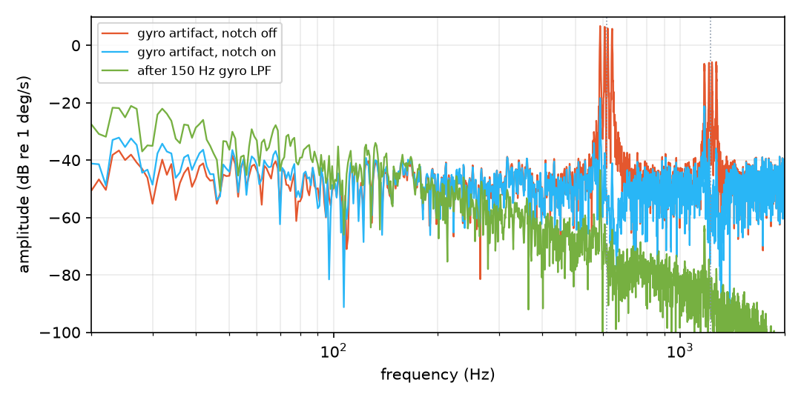
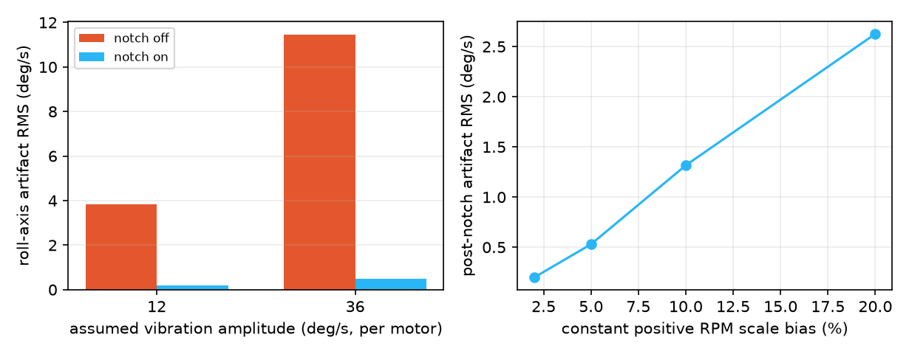

# Task 1.6b - motor vibration and RPM notch filter

Generated by `sim/vibration_report.py` in 252 s. **Checks: PASS**

All vibration parameters are **ASSUMED synthetic stress values**, not measurements. The model adds a gyro artifact only; it does not add body forces, torques or frame resonance. Hardware blackbox data is required before drawing conclusions about a real airframe.

## Method

- Same seed, IMU noise and vibration disturbance with the filter on and off; vibration phases use a separate seeded RNG (`MotorVibration`), so the comparison is fair.
- Hover: 2 s takeoff, 4 s settling, then 1 s recorded at 4 kHz (4 kHz board profile, 150 Hz gyro LPF).
- Artifact = logged gyro minus the true body roll rate, so sensor noise is separated from real motion.
- Motor activity is the RMS of motor commands above 250 Hz, a proxy for ESC/actuator stress, not thrust.
- RPM reports are delivered at 100 Hz with one report (10 ms) latency and a constant positive, common-mode scale bias. Negative bias, random jitter and independent per-motor errors are not tested here.
- 1x/2x mechanical rotation frequencies, Q = 5, targets below 500 Hz or at/above 45 % of the sample rate are skipped (no aliased filtering).
- At 1 kHz the 450 Hz upper cap is below the 500 Hz floor: the bank is always an exact bypass.

## Hover: artifact and tracking

Worst over seeds 4, 7, 11 per cell.

| Assumed amplitude (deg/s) | Notch | Gyro artifact RMS | Post-notch RMS | After LPF | Hover max error | Motor >250 Hz |
| --- | --- | --- | --- | --- | --- | --- |
| 0 | off | 0.13 deg/s | 0.13 deg/s | 0.20 deg/s | 0.24 cm | 1.88 % |
| 0 | on | 0.13 deg/s | 0.12 deg/s | 0.24 deg/s | 0.24 cm | 1.88 % |
| 12 | off | 3.82 deg/s | 3.82 deg/s | 0.28 deg/s | 0.24 cm | 3.06 % |
| 12 | on | 3.83 deg/s | 0.20 deg/s | 0.24 deg/s | 0.24 cm | 1.88 % |
| 36 | off | 11.46 deg/s | 11.46 deg/s | 0.59 deg/s | 0.23 cm | 7.44 % |
| 36 | on | 11.48 deg/s | 0.50 deg/s | 0.24 deg/s | 0.23 cm | 1.89 % |

The notch removes most of the modeled 1x/2x gyro content. At these amplitudes the existing 150 Hz two-pole gyro LPF already attenuates it before the controller, so **position tracking does not measurably improve**. The reproducible benefit is lower high-frequency motor-command activity; the table shows that it returns close to the zero-vibration baseline. Real frames can also have lower-frequency structural resonances that this model does not represent.

## Figure-8 tracking (C SITL)

| Assumed amplitude | Notch | Max 3D error | RMS error | Tumble / asserts |
| --- | --- | --- | --- | --- |
| 12 deg/s | off | 4.10 cm | 2.78 cm | no |
| 12 deg/s | on | 4.10 cm | 2.79 cm | no |
| 36 deg/s | off | 4.09 cm | 2.78 cm | no |
| 36 deg/s | on | 4.10 cm | 2.79 cm | no |

Both cases stay inside the 10 cm simulation gate. As above, the notch does not change tracking here; the figure-8 entry transient is included only after the declared 2 s window.

## RPM telemetry error and dropout

| Constant positive RPM scale bias | Post-notch artifact | Hover max error |
| --- | --- | --- |
| 2 % | 0.20 deg/s | 0.24 cm |
| 5 % | 0.53 deg/s | 0.24 cm |
| 10 % | 1.32 deg/s | 0.23 cm |
| 20 % | 2.63 deg/s | 0.24 cm |

50 ms after the last report: `rpmFresh` = 1; 150 ms after: 0 (bank bypassed); after recovery: 1. Invalid packets do not refresh the age (C test `test_rpm_notch` and `test_fc_step::test_rpm_timeout_bypasses_and_invalid_packets_do_not_refresh`).
Actual signal-path equality during stale telemetry: **PASS**; maximum recorded hover error including dropout and recovery: 0.24 cm.

A detuned notch leaves residual vibration but did not destabilize these runs. This is not a guarantee for larger RPM errors, wrong pole-pair conversion, or motor speeds outside the modeled range.

## Stability impact (linear, roll-rate loop)

| Case | Phase margin | Gain margin |
| --- | --- | --- |
| Nominal, no notch | 63.4 deg | 15.5 dB |
| Nominal, eight notches at hover RPM (+2 % error) | 61.3 deg | 14.1 dB |
| Worst of 32 corners at modeled hover RPM | 47.5 deg | 7.2 dB |
| Worst sampled RPM/corner combination | 46.2 deg | 6.9 dB |

At modeled hover RPM the bank adds 0.9 deg of phase lag at 10 Hz and 1.8 deg at 20 Hz. The initial 150 Hz floor failed off-hover analysis (30.9 deg / 3.8 dB at a 150 Hz fundamental). The floor is now 500 Hz per section to retain margin above the G1 thresholds of 45 deg / 6 dB.

Sweep fundamental frequencies (Hz): 0, 249.9, 250, 400, 499.9, 500, 550, 600, 750, 899.9, 900, 1200, 1799.9, 1800, 3000. Each is checked across 32 uncertainty corners, with coincident motor speeds and the model's per-motor scale factors, plus modeled hover RPM. Both harmonic-only and full-bank operation are included. This is a fixed-coefficient, Q=5 linear analysis using a Python transcription of the RBJ equations, not a proof for continuous RPM, arbitrary independent speeds, retuning transients, other Q values, or hardware. The C implementation is covered separately by `test_rpm_notch`.

## Checks

- PASS - Assumed-vibration hover stays within 5 cm
- PASS - Notch reduces the modeled artifact by at least 4x
- PASS - Figure-8 stays within 10 cm with the notch
- PASS - No tumble or assertion in any vibration run
- PASS - Sampled RPM sweep across 32 corners keeps PM >= 45 deg and GM >= 6 dB
- PASS - Dropout signal bypasses exactly, holds within 5 cm, and recovers

## Limits

- No measured vibration spectrum, RPM calibration, ESC telemetry latency or frame resonance.
- Electrical eRPM must be converted with the motor pole-pair count; the API takes mechanical RPM.
- The filter cannot recover a saturated or aliased gyro, and it cannot fix a wrong RPM source.
- The 4 kHz loop is host/SITL only; P4 timing, IMU/ESC drivers and hardware flight are unvalidated.
- `FLOW-01` (flow-only absolute XY drift) is unaffected by this work.
